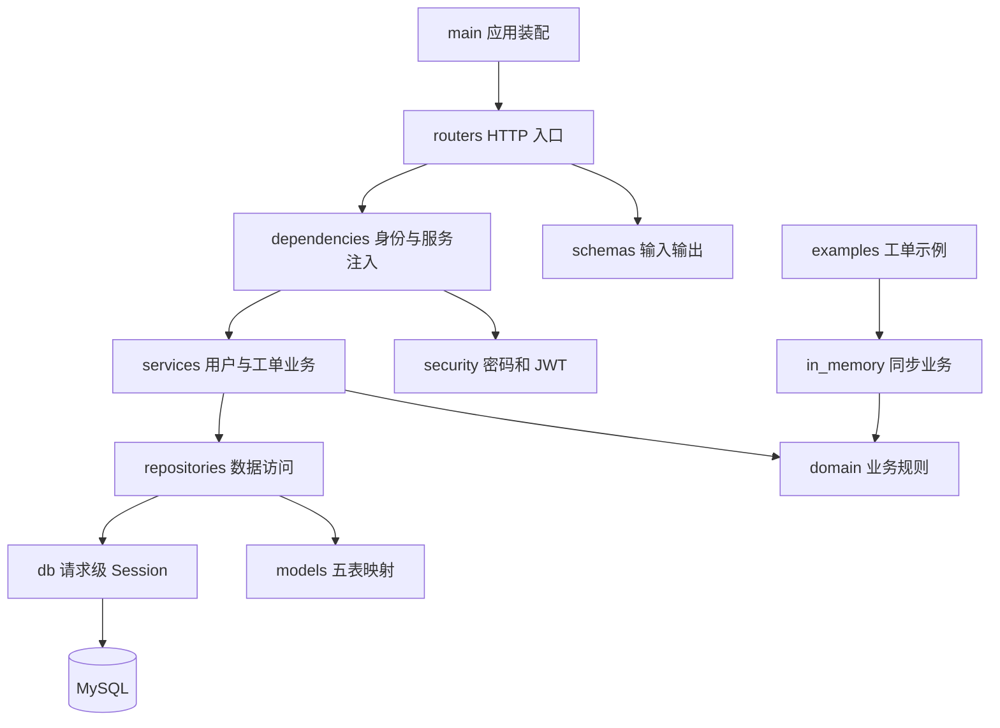

# HelpFlow 文件职责与依赖

仓库按业务职责组织，更新日期：2026-11-02。正式 API 使用异步 MySQL，支持身份认证、用户管理、工单流转、回复和活动时间线。

## 目录

```text
backend/
├── app/
│   ├── domain/          # 枚举、业务异常与工单流转规则
│   ├── routers/         # auth、users、tickets、health HTTP 入口
│   ├── services/        # 用户与工单业务、权限和写事务
│   ├── repositories/    # 用户与工单查询、行锁及数据写入
│   ├── models/          # 五张业务表的 SQLAlchemy 映射
│   ├── db/              # ORM 基类、UTC 时间、引擎和会话
│   ├── in_memory/       # 内存数据类、存储及同步业务实现
│   ├── schemas.py       # 输入校验、输出白名单及分页
│   ├── dependencies.py  # 会话、服务、身份与角色依赖
│   ├── security.py      # Argon2 密码与 JWT
│   ├── errors.py        # HTTP 业务错误
│   ├── exception_handlers.py
│   ├── middleware.py    # 请求日志与耗时
│   ├── config.py        # 环境变量和配置
│   └── main.py          # 应用装配与生命周期
├── alembic/             # 数据库结构迁移
├── scripts/             # 管理员初始化
├── examples/            # 内存工单流程、异步 I/O 示例
├── sql/                 # 建表、数据、查询、索引、事务和 CRUD
└── tests/               # 按功能命名的回归和集成测试
docs/
├── requirements/        # PRD 与需求确认
├── architecture/        # 前后端设计、文件职责与 decisions 历史设计
└── guides/              # 按功能组织的操作指南
frontend/                # Vue 3 页面、共享组件、认证、路由和 API
```

## 业务与依赖



正式业务依赖 `app/domain`，状态流转表位于 `domain/workflow.py`。内存实现供示例和替换依赖的 HTTP 测试使用；正式 API 的 Service 不依赖内存实现。


| 业务                                 | 主要入口与实现                                                      | 验证                                                                     |
| -------------------------------------- | --------------------------------------------------------------------- | -------------------------------------------------------------------------- |
| 注册、登录、当前用户、修改密码       | routers/auth.py、services/users.py、security.py                     | tests/test_security.py                                                   |
| 用户查询、角色、启用状态与管理日志   | routers/users.py、services/users.py、repositories/users.py          | tests/test_security.py                                                   |
| 工单创建、筛选、分页与修改           | routers/tickets.py、services/tickets.py、repositories/tickets.py    | tests/test_http.py、tests/test_api_validation.py、tests/test_database.py |
| 领取、分配、撤销、流转、回复和时间线 | services/tickets.py、domain/workflow.py                             | tests/test_ticket_workflow.py                                            |
| 健康检查、错误、CORS、日志和校验     | routers/health.py、exception_handlers.py、middleware.py、schemas.py | tests/test_http.py、tests/test_api_validation.py                         |
| 数据持久化、事务与结构迁移           | db、models、alembic                                                 | tests/test_database.py                                                   |
| asyncio 示例                         | examples/async_io.py                                                | tests/test_async_io.py                                                   |

上表代码路径均相对于 `backend/`。ORM 映射 User、Ticket、Comment、Activity、UserAdminLog；业务修改与对应日志在同一事务提交。Repository 不提交事务，Service 负责提交与回滚。

## 数据库和脚本

`alembic/versions/001_five_tables.py` 创建五张业务表，`002_ticket_updated_at.py` 增加工单更新时间。迁移自包含，不读取当前 ORM 或示例 SQL 重建历史结构。应用不自动迁移或建表。

`sql/01_schema.sql` 至 `06_crud.sql` 使用已有示例库名 `helpflow_stage4`，避免目录调整改变数据库目标。正式 API 使用配置中的数据库。集成测试沿用 `helpflow_stage5_test` 数据库前缀校验，必须显式设置 `HELPFLOW_TEST_DATABASE_URL`；未配置时跳过真实 MySQL 用例。

## 文档入口

- [需求确认](../requirements/confirmation.md) 与 [PRD](../requirements/prd.md)
- [后端设计](backend.md) 与 [前端设计](frontend.md)
- [数据库配置与迁移](../guides/database.md)
- [认证与权限](../guides/security.md)
- [工单操作与时间线](../guides/ticket-workflow.md)
- [独立 SQL](../guides/sql.md) 与 [asyncio 示例](../guides/async-io.md)

`decisions/` 保存按主题命名的历史设计。部分指南保留早期接口示例，文首已标注其版本限制；当前认证和工单行为以对应业务指南及代码为准。

## 审查修复补充（2026-11-03）

- `app/pagination.py`：统一页码、每页数量、数据库 ID 的输入边界。
- `app/rate_limit.py`：单进程 IP/账号滑动窗口限流，容量有界；多实例部署配置共享网关限流。
- `repositories/tickets.py`：权限范围内的 SQL 筛选与统计、最近工单查询，以及回复和时间线的 `before_id` 游标分页。
- `frontend/src/views/SessionUnavailableView.vue`：临时网络或服务端故障时保留会话并支持重试。
- `backend/tests/test_api_hardening.py`、`test_ticket_queries.py`：边界参数、限流、数据库筛选权限与稳定游标验证。
- `.github/workflows/ci.yml`、`frontend/e2e/workflow.spec.js`：包含独立 MySQL 的自动回归和三角色浏览器流程。

## 阶段12协作与通知

- `backend/alembic/versions/003_collaboration.py`：备注可见性、转交活动类型与通知表迁移，阻止内部备注有损回退。
- `backend/app/services/tickets.py`：负责客服转交、备注权限与分配/回复通知，业务写入共用事务。
- `backend/app/services/notifications.py`、`routers/notifications.py`：事件与接收人去重、本人的通知列表、未读数和幂等已读。
- `frontend/src/components/InternalNotes.vue`、`views/NotificationsView.vue`：内部备注及通知界面；工单详情增加转交弹窗。
- `backend/tests/test_stage12.py`：内部信息隔离、转交竞争、异常回滚、通知幂等；浏览器回归增加两名客服的转交闭环。
- `backend/scripts/benchmark_summary.py`：隔离测试库中的分页与聚合实测及 EXPLAIN 导出。
- [阶段12运行与验证](../guides/stage12-collaboration.md)、[升级需求](../upgrades/v1.1-collaboration-requirements.md)。

## 阶段13 SLA 与调度

- `backend/alembic/versions/004_sla.py`：规则、工单快照、幂等事件及微秒时间迁移。
- `backend/app/services/sla.py`：规则快照、首次响应、终止等待、提醒和超时事务通知。
- `backend/app/sla_scheduler.py`：有超时限制的 Redis 索引操作和提交后的更新。
- `backend/scripts/scan_sla.py`：独立扫描进程、批量到期查询、数据库补偿和运行指标。
- `backend/scripts/configure_sla.py`、`measure_sla.py`：发布新版本规则、隔离测试库实测与清理。
- `frontend/src/components/TicketSLA.vue`：详情 SLA 与升级记录；首页和列表增加授权范围内的筛选。
- `backend/tests/test_stage13.py`：临界时间、幂等竞争、回滚、Redis 故障和补偿恢复；CI 另启真实 Redis 服务。
- [阶段13运行与验证](../guides/stage13-sla.md)、[设计](decisions/2026-11-03-stage13-sla-design.md)。
