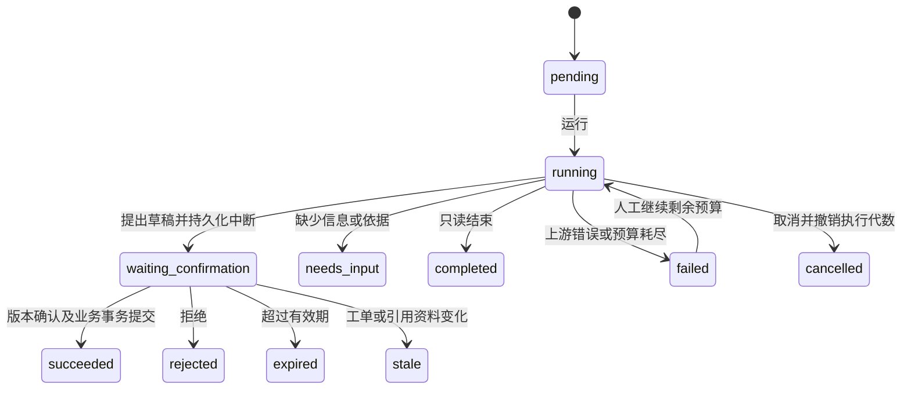

# 客服任务助手

当前负责客服在未关闭工单详情使用“客服任务助手”。已有“AI 回复助手”、手动回复、内部备注与工单流程保留。

## 使用

1. 选择“整理内部交接摘要”或“拟公开回复”，填写要求，点击“新建并运行任务”。
2. 查看查询、读取记录和检索进度。模型可以继续查资料、结束只读查询，或要求补充信息。
3. 出现提案后核对全文、用途和来源。修改正文后先“保存修改”，得到新版本。
4. 点击“确认保存内部备注”或“确认公开发送”，核对弹窗中的目标工单、版本和完整正文，再确认。也可以拒绝提案。
5. 成功时显示实际记录ID；刷新仍能在历史任务中找到结果。公开回复正常触发通知和首次响应 SLA，内部备注不触发公开响应 SLA。

内部摘要的工具允许读取内部备注；公开回复任务只读公开沟通记录和公开知识。任务创建后用途不可变，不能把摘要任务改成公开发送。所有工单数据都按不可信输入处理，模型无法执行任意代码、SQL、URL或修改其他工单。

“只读任务已结束”与“需要补充信息”均没有写入工单。补充资料后新建任务。没有退款政策时会要求补充依据，不应承诺“十分钟退款”或编造到账时间；当前公开知识库不含真实退款政策。

## 安装与升级

在 `backend` 目录执行：

```powershell
uv sync --locked
# 先按当前数据库运维方式完成备份。
uv run alembic upgrade head
uv run alembic check
```

迁移 `006_agent` 新增 `agent_tasks` 与 `agent_executions`，不修改既有工单记录。回退会删除Agent任务及执行去重记录，务必备份；不要在运行中的任务仍可被确认时回退。

沿用后端 `.env` 中 DeepSeek 的生成配置与独立 Embedding 配置，不需要第三个Key。默认配置：

| 配置 | 默认值 | 用途 |
| --- | --- | --- |
| `HELPFLOW_AGENT_TIMEOUT` | 180 | 每次运行总超时，秒 |
| `HELPFLOW_AGENT_CONFIRMATION_SECONDS` | 900 | 提案有效期，编辑不续期 |
| `HELPFLOW_AGENT_CHECKPOINT_PATH` | backend/.local/agent-checkpoints.sqlite | SQLite检查点，可设绝对路径 |

重启后端、刷新前端即可使用。若前端采用静态部署，需要在 `frontend` 执行 `npm run build` 并更新静态文件。生产启动命令保持原有方式。

SQLite及其WAL文件包含工单上下文，只放在受保护的持久化本地磁盘，`.local/`已被Git忽略。备份/恢复应同时考虑MySQL与SQLite；不能把本地SQLite当作跨主机高可用方案。应用关闭LangSmith追踪，不向追踪服务发送工单。对模型供应商的调用仍会发送该任务权限允许的必要上下文。

## 状态与恢复



每个任务累计最多6次模型调用、8次工具调用（含提出提案/结束工具）。每次运行总时间有上限，单个网络请求沿用RAG超时。普通文字结束会收到一次格式提示后继续工具循环，仍消耗原六轮预算，不无限重试。同一客服同时只有一个有效运行租约；不同进程通过MySQL锁和租约协调。

工具读取每页最多10条记录，显式提供 `has_more`、更早游标及覆盖说明。前端展示读取页数相关进度，模型不能把局部记录当作全部历史。

HTTP超时后先“查询任务状态”，不要马上新建重复任务。若进程退出导致任务停在运行中，租约到期（本次运行上限再加30秒）后可“继续运行”。继续使用已保存的模型消息和工具结果，调用预算不重置；旧执行者不能覆盖新执行者结果。取消会阻止后续步骤及写入，但无法保证撤销已经发给供应商的请求或费用。

等待确认时刷新/重启不会重新生成正文。修改产生新提案版本，旧版本不能确认。任何新增沟通记录、工单内容/状态、负责人、密码版本或所引用知识版本变化，都会阻止旧提案执行。转交后原客服不能再查询任务内容，新负责人也不能读取其他客服的任务，应自行新建。

检查点损坏或丢失时，未完成任务不能猜测恢复；未确认提案不能继续写入，需要新建。若MySQL已经记录成功，即使检查点丢失也能查询或重复确认得到同一结果。提交后调度失败依赖既有SLA补偿扫描，不重复发送公开回复。

## 接口

均位于 `/api/v1`，使用已有Bearer认证与统一 `code/message/data` 响应。仅任务创建客服且仍为工单当前负责人有权限。

| 方法与路径 | 参数/行为 |
| --- | --- |
| POST `/tickets/{id}/agent-tasks` | `request_id`、`mode`、`instruction`；用户与请求ID去重，同ID不同输入409 |
| GET `/tickets/{id}/agent-tasks` | `limit=10`（最多30）、`before=任务ID`，按创建时间分页 |
| GET `/agent-tasks/{id}` | 当前状态、正文、来源、工具摘要、提案版本、有效期、结果ID |
| POST `/agent-tasks/{id}/run` | 运行或继续；等待确认/已结束时不重新生成 |
| PATCH `/agent-tasks/{id}/proposal` | `version`、`content`，保存新提案版本 |
| POST `/agent-tasks/{id}/confirm` | 只接受 `version`，不可夹带替换正文、身份或用途 |
| POST `/agent-tasks/{id}/reject` | 拒绝待确认提案 |
| POST `/agent-tasks/{id}/cancel` | 取消任务并撤销运行代数 |

模型只可调用 `get_ticket`、`read_records`、`search_knowledge`、`propose_action`、`finish`。参数严格校验，多余字段和任意工单ID被拒绝。公开回复引用只能来自任务实际检索到且仍有效的知识版本。

确认按用户→工单→任务顺序加锁，在同一事务中调用原 `TicketService` 的写入方法，同时保存唯一执行记录和成功结果。因此并发确认、重复点击、业务提交成功而响应丢失，都只产生一个备注/回复及对应通知。LangGraph检查点不承担业务去重职责。

## 验证与复现

隔离库名必须以 `helpflow_stage5_test` 开头。后端测试、浏览器和真实模型评测使用不同数据库，避免不同向量模型的索引相互污染。

后端：设置 `HELPFLOW_TEST_DATABASE_URL` 后在 `backend` 执行 `uv run pytest -q`；聚焦用例为 `tests/test_stage15.py`。涵盖权限隔离、公开记录过滤、分页、非法工具、预算、超时、版本、过期、知识变更、租约竞争、事务回滚、并发确认、响应丢失、进程/检查点恢复与丢失处理。

浏览器：将 `HELPFLOW_DATABASE_URL` 与 `HELPFLOW_TEST_DATABASE_URL` 都指向独立浏览器库，升级后在 `backend` 执行 `uv run python -m tests.seed_agent_browser`；随后在 `frontend` 设置 `$env:E2E_AGENT='1'`，执行 `npm run test:e2e`。必要时设置 `E2E_BROWSER_PATH`。该服务入口 `tests.agent_browser_app` 仅供测试，模型由明确的替身提供，数据库、路由、确认事务和界面仍为实际实现。不要使用此入口运行实际业务。

真实模型：设置第三个独立测试库并升级，后端保持现有生成与Embedding配置，执行：

```powershell
uv run python -m scripts.evaluate_agent --output .local/agent-evaluation.json
```

脚本导入仓库公开知识、创建不能登录的合成客服与合成工单，运行六类任务，记录模型、阈值、工具顺序、次数、耗时、正文、来源及状态；不确认、不发送任何提案。会产生供应商调用费用。
