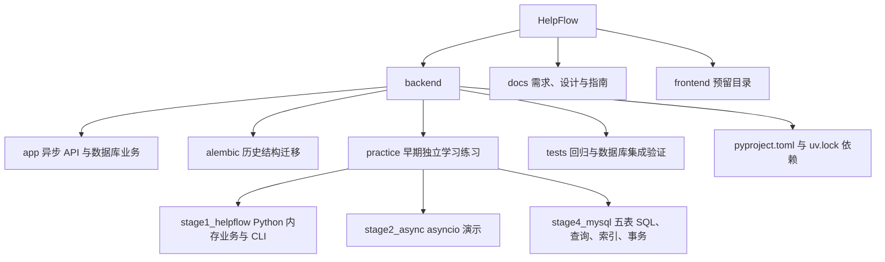
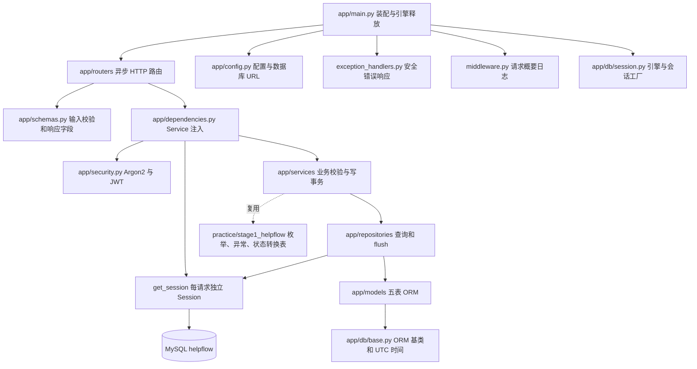
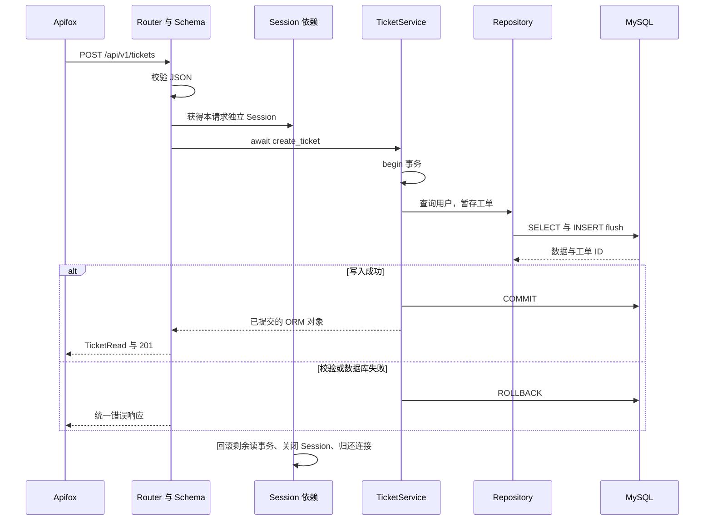
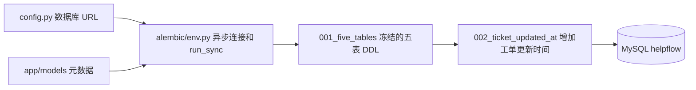

# HelpFlow 文件职责与关系图

本文记录实际代码结构。当前对应阶段七工单核心业务与时间线，更新日期 2026-11-02。新增或调整文件职责时同步维护本文；历史设计保存在 docs/superpowers/specs/。

HTTP API 现已使用 MySQL。阶段一内存业务、阶段二异步练习和阶段四 SQL 练习独立保留；frontend 当前为空。已完成登录、JWT、角色和工单归属权限，以及领取、分配、撤销、状态流转与工单活动时间线。

## 1 项目结构

## 2 正式 API 的依赖

箭头从调用方指向被调用方。请求不再调用 MemoryStorage；异步 Service 复用早期枚举、异常和状态转换规则。

| 文件 | 职责 |
| --- | --- |
| backend/app/main.py | create_app 创建应用和引擎，注册路由、CORS、错误和请求日志，退出释放引擎 |
| backend/app/config.py | 读取 HELPFLOW_ 环境变量及 backend/.env；数据库 URL 使用 SecretStr |
| backend/app/db/base.py | DeclarativeBase、UTCDateTime 与 UTC 当前时间 |
| backend/app/db/session.py | AsyncEngine、会话工厂、UTC 连接约定、请求级 yield 依赖与回滚关闭 |
| backend/app/models/__init__.py | User、Ticket、Comment、Activity、UserAdminLog 五表映射、关系、索引、约束 |
| backend/app/dependencies.py | 创建异步 Service；Bearer Token 认证、数据库当前身份与 require_roles 角色依赖 |
| backend/app/repositories/users.py | 用户 ID、邮箱、分页筛选查询及添加；不 commit |
| backend/app/repositories/tickets.py | 工单查询、行锁读取、条件 UPDATE 领取、筛选分页 count、回复及作者批量加载、活动排序查询；不 commit |
| backend/app/services/users.py | 注册、登录、修改密码、用户管理限制与管理日志事务 |
| backend/app/services/tickets.py | 工单创建修改、领取分配撤销、状态与回复规则；业务与活动同事务提交；生成工单号，默认分类 other |
| backend/app/routers/auth.py | 注册、登录、当前用户和修改密码；Argon2 哈希与 JWT |
| backend/app/routers/users.py | 管理员用户列表、详情、角色与启用状态管理；移除公开创建入口 |
| backend/app/routers/tickets.py | 工单 CRUD、列表筛选排序分页、领取分配撤销、状态、回复与时间线；异步 await Service |
| backend/app/routers/health.py | 健康检查与旧地址兼容；不查询数据库 |
| backend/app/schemas.py | Pydantic 输入校验、局部更新、输出白名单、统一响应和分页；保留旧别名 |
| backend/app/exception_handlers.py | 业务错误和校验统一转换，数据库错误脱敏，数据库日志仅记录类型 |
| backend/app/middleware.py | 请求方法、路径、状态、耗时与 X-Process-Time，不记录请求内容或 Token |
| backend/.env.example | 配置名称及占位连接串；真实 .env 被 Git 忽略 |

SQLAlchemy Model 保存数据库结构，Schema 表达 HTTP 格式。ORM 关系默认禁止隐式加载；需要关系时由 Repository 明确选择加载策略。用户角色和启用状态修改写入用户管理日志；工单创建、修改、领取、分配、撤销及状态流转写入独立活动日志，回复保存于沟通表。

## 3 一次创建工单请求

## 4 Alembic 与数据库结构

| 文件 | 职责 |
| --- | --- |
| backend/alembic.ini | 脚本目录与导入路径；不保存密码 |
| backend/alembic/env.py | 在线异步迁移、离线 SQL、autogenerate 元数据与类型比较 |
| backend/alembic/script.py.mako | 新 revision 的模板 |
| backend/alembic/versions/001_five_tables.py | 自包含五表基线，回退按依赖反序删除表 |
| backend/alembic/versions/002_ticket_updated_at.py | 添加或移除 tickets.updated_at，用于字段升降级练习 |

应用不调用 create_all，也不自动执行迁移。历史迁移不读取现在的 Model 或阶段四 SQL 文件；只有生成新迁移时才使用当前元数据进行比较。

## 5 独立练习与测试

| 文件或目录 | 职责及与正式应用的关系 |
| --- | --- |
| practice/stage1_helpflow/models.py | 内存 User、Ticket、Comment 数据类；与 ORM 类分别存在 |
| practice/stage1_helpflow/storage.py | MemoryStorage 字典与 ID；正式 API 不再使用 |
| practice/stage1_helpflow/services.py | 原同步内存业务；异步业务复用其状态转换表 |
| practice/stage1_helpflow/enums.py | 角色、状态、优先级；仍由正式应用复用 |
| practice/stage1_helpflow/exceptions.py | 业务异常；仍由正式应用复用 |
| practice/stage1_helpflow/main.py、logging_config.py | 阶段一 CLI 与日志 |
| practice/stage2_async/async_demo.py | asyncio 串行、Task、gather、to_thread 独立练习 |
| practice/stage4_mysql/01_schema.sql | helpflow_stage4 五表首次建库建表 |
| practice/stage4_mysql/02_seed.sql | 五用户、五工单、回复与日志示例数据 |
| practice/stage4_mysql/03_queries.sql | 分页、筛选、JOIN、统计、时间线查询 |
| practice/stage4_mysql/04_indexes.sql | SHOW INDEX 与 EXPLAIN |
| practice/stage4_mysql/05_transactions.sql | 提交、真实唯一约束错误、回滚和结果检查 |
| practice/stage4_mysql/06_crud.sql | 临时表建表、改表和增删改查 |
| tests/async_memory.py | 测试专用适配器，让早期同步 Service 可被异步路由调用 |
| tests/test_stage2_http.py | 早期 HTTP 流程、错误、分页与 CORS 回归 |
| tests/test_stage2_async.py | 并发结果和事件循环响应验证 |
| tests/test_stage3_api.py | 注册、修改、搜索排序、校验、日志和配置回归 |
| tests/test_stage5_database.py | 独立 MySQL 迁移、API 持久化、回滚、Session 隔离、升降级与元数据检查 |
| pyproject.toml、uv.lock | Python 版本与依赖；SQLAlchemy asyncio extra、asyncmy、Alembic、FastAPI、pytest |

阶段四脚本和正式 API 连接不同数据库；它们没有运行时调用关系。早期 HTTP 回归使用替换依赖的内存对象，集成测试才真正访问 MySQL。

## 6 文档和阅读顺序

1. docs/stage5-database-guide.md：配置、建库、迁移、启动、接口操作与验证。
2. app/main.py → db/session.py → dependencies.py：应用与会话生命周期。
3. routers → schemas → services → repositories → models：追踪一次 HTTP 请求。
4. alembic/env.py 和两版迁移：区分当前模型与历史数据库结构。
5. tests/test_stage5_database.py：理解提交失败后的回滚、并发会话与迁移验证。
6. 学习 SQL 时单独阅读 docs/stage4-mysql-guide.md 和 stage4_mysql 的六个脚本。
7. 复习基础时对照 stage1_helpflow、stage2_async 和相应阶段二、三指南；旧指南中的内存说明属于历史版本。

需求和总体设计见 requirements-confirmation.md、prd.md、backend-design.md、frontend-design.md。历史设计包括阶段一 scaffold、gitignore，阶段二 HTTP 与剩余练习，阶段三 FastAPI，阶段四 MySQL，以及 2026-11-02-stage5-async-database-design.md。

## 阶段六新增文件

| 文件 | 职责 |
| --- | --- |
| backend/app/security.py | Argon2 密码哈希、线程池校验、固定 HS256 JWT、密码版本 HMAC |
| backend/app/errors.py | 携带 HTTP 状态和业务错误码的 AppError |
| backend/scripts/init_admin.py | 隐藏输入密码、幂等创建管理员、拒绝对既有普通账号自动提权 |
| backend/tests/conftest.py | 每个测试进程临时随机 JWT 密钥 |
| backend/tests/test_stage6_security.py | 密码、JWT、三角色归属、即时禁用和改密、管理日志与回滚验证 |
| docs/stage6-security-guide.md | 配置、初始化管理员、Apifox 三角色验证与阶段边界 |
| docs/superpowers/specs/2026-11-02-stage6-security-design.md | 阶段六实施设计与验收范围 |

受保护请求先验证 Token，在短事务内查询数据库当前用户，再进入 Service 业务事务。所有工单写入身份来自当前用户；请求不再接收 creator_id 或 author_id。

## 阶段七新增文件

| 文件 | 职责 |
| --- | --- |
| backend/tests/test_stage7_workflow.py | 真实 MySQL 完整流转、活动权限、撤销与分配校验、并发领取及日志/提交失败原子回滚 |
| docs/stage7-workflow-guide.md | 阶段七接口、三角色 Apifox 操作顺序、事务与并发解释及测试说明 |
| docs/superpowers/specs/2026-11-02-stage7-ticket-workflow-design.md | 阶段七实施范围、接口规则、事务设计与验收范围 |

阶段七复用既有五表，无新增迁移。状态操作同时提供 POST（总体设计路径）和 PATCH（阶段六兼容路径），二者调用同一业务方法。
