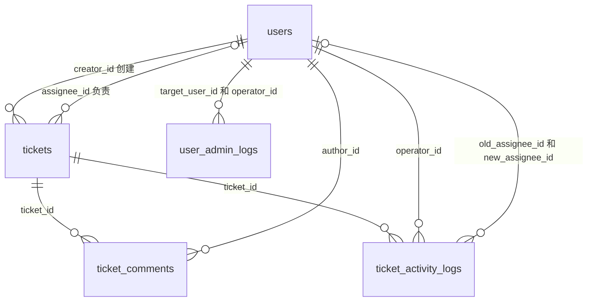

# HelpFlow 阶段四 MySQL 与 SQL 实践指南

本阶段学习数据库本身：设计五表、手写 SQL、观察索引、验证提交和回滚。SQL 位于 `backend/practice/stage4_mysql/`，与阶段三内存 API 独立；执行 SQL 后，Apifox 仍访问内存数据。阶段五再通过 SQLAlchemy Async 接入数据库。

## 1 运行环境与顺序

使用 MySQL 8.0.16 或更新版本（建议 8.0 / 8.4），需要支持真正执行 CHECK 约束。所有表使用 InnoDB。练习库固定为 `helpflow_stage4`，请在本地学习实例运行。账号需要建库建表、读写及创建、执行、删除存储过程的权限；脚本不创建数据库账号或记录密码。

推荐在 PowerShell 中逐文件批处理，遇到 SQL 错误立即停止。以下命令会为每个文件提示输入数据库密码（`-p`），不要把密码写入命令或脚本：

```powershell
$mysql = 'C:\Program Files\MySQL\MySQL Server 8.0\bin\mysql.exe'
$sqlDir = 'D:\vscode\HelpFlow\backend\practice\stage4_mysql'
$OutputEncoding = [System.Text.UTF8Encoding]::new($false)
Get-ChildItem -LiteralPath $sqlDir -Filter '*.sql' | Sort-Object Name | ForEach-Object {
    Write-Host $_.Name
    Get-Content -LiteralPath $_.FullName -Raw -Encoding UTF8 |
        & $mysql --default-character-set=utf8mb4 --batch -h 127.0.0.1 -P 3306 -u root -p
    if ($LASTEXITCODE -ne 0) { throw "SQL 执行失败：$($_.Name)" }
}
```

根据安装位置调整 `$mysql`、`$sqlDir` 和端口。只想执行一个文件时，将 `Get-ChildItem` 的 `-Filter` 改为对应文件名。

也可以交互登录 `mysql --default-character-set=utf8mb4 -h 127.0.0.1 -P 3306 -u root -p` 后按顺序 SOURCE（以下为 mysql 客户端命令，不是 PowerShell 命令）：

```sql
SOURCE D:/vscode/HelpFlow/backend/practice/stage4_mysql/01_schema.sql;
SOURCE D:/vscode/HelpFlow/backend/practice/stage4_mysql/02_seed.sql;
SOURCE D:/vscode/HelpFlow/backend/practice/stage4_mysql/03_queries.sql;
SOURCE D:/vscode/HelpFlow/backend/practice/stage4_mysql/04_indexes.sql;
SOURCE D:/vscode/HelpFlow/backend/practice/stage4_mysql/05_transactions.sql;
SOURCE D:/vscode/HelpFlow/backend/practice/stage4_mysql/06_crud.sql;
```

`SOURCE`、`DELIMITER` 是 mysql 客户端命令，不能直接当作普通 SQL 经驱动发送。GUI 中需使用“执行脚本”并支持分隔符，推荐先按上述命令行运行。

建表、种子数据仅首次执行，不提供自动删库重建。已有表会报错，重复种子导入会主键冲突。推荐使用上述批处理：不要添加 `--force`，失败后客户端退出并回滚未提交事务，DDL 不会被撤销。交互 SOURCE 可能在错误后继续执行，不适合验证错误路径；请先确认空库，逐文件检查输出，报错后执行 `ROLLBACK;` 并排查。只读查询、索引观察、事务和 CRUD 练习可重跑。每次事务演示会多留下一张演示工单和一条创建记录，这是预期行为。

## 2 五表关系



字段依据 `backend-design.md` 第 10 节。`users` 表示账号，`tickets` 保存当前工单，`ticket_comments` 保存回复，`ticket_activity_logs` 保存工单事件，`user_admin_logs` 保存管理员管理用户的记录。

外键保证关联对象存在，不能保证关联用户是客服、操作者是管理员或状态变化合法；这些规则由后续 Service 与权限层检查。日志只追加、不提供普通修改和删除接口属于应用约定，当前 SQL 账号并未通过权限配置强制为只写。数据库也不自动生成业务日志，业务写入必须显式包含日志。

`email` 与 `ticket_no` 唯一。邮箱输入去空白、转小写由后续应用负责，种子值已规范化。枚举保存为 VARCHAR，并用 CHECK 限定取值。NULL 表示没有负责人或尚未关闭，查询必须用 `IS NULL`。业务时间使用 UTC：每个写入脚本设置会话时区为 `+00:00`；DATETIME 本身不存时区，阶段五也要维持这个连接约定。

密码字段使用 `!stage4-no-login` 无效占位值，不是真实密码或可登录的 Argon2 哈希。认证和初始化管理员留到阶段六。

## 3 示例数据与查询预期

导入种子后、运行事务演示前，五表行数依次为：

| 表 | 行数 |
| --- | ---: |
| users | 5 |
| tickets | 5 |
| ticket_comments | 3 |
| ticket_activity_logs | 11 |
| user_admin_logs | 1 |

用户 1、2 是普通用户，3 是客服，4 是管理员，5 是停用用户。工单 1、5 待领取，2 正在处理，3 已解决，4 已关闭。

`03_queries.sql` 的默认参数与结果：

| 查询 | 预期结果 |
| --- | --- |
| 用户 1 工单，时间倒序 | ID 2、1；total=2 |
| 待领取工单，时间正序 | ID 1、5 |
| 客服 3 正在处理的工单 | ID 2 |
| 状态数量 | open=2，其余三种状态各 1 |
| 未关闭且工单数至少 2 的创建人 | 用户 1、2 各 2 张 |
| 创建人与负责人关联查询 | 5 行，工单 1、5 的负责人为 NULL |
| 工单 2 回复 / 活动 | 2 条回复 / 2 条活动 |
| 优先级与关键词查询 | 工单 2、1 |
| 用户 5 管理日志 | 一条 account_disabled |

调整文件开头的会话变量观察结果；`LIMIT 10 OFFSET 0` 表示第一页，实际应用页偏移量为 `(page - 1) * page_size`。列表和 count 要使用相同筛选条件。相同时间再按 ID 排序，避免分页顺序不确定。学习 SQL 字符串常量后，阶段五改用绑定参数，不能将用户输入拼进 SQL。

## 4 索引观察

`04_indexes.sql` 通过 `SHOW INDEX` 和 `EXPLAIN` 观察索引，关注 `possible_keys`、`key`、`type`、`rows` 和 `Extra`。`rows` 是估算扫描行数，不是查询结果数。

联合索引 `(creator_id, created_at, id)` 支持按创建人查询及时间排序；`(assignee_id, status, created_at, id)` 支持客服状态列表。它们已覆盖外键首列，不再添加重复单列索引。相比总设计，组合索引末尾显式加入 ID 以配合稳定排序；活动表还为两个负责人外键补齐索引。

小样本上优化器可能选择全表扫描；这是成本选择，不意味着索引无效。`LIKE '%词%'` 也不能期待普通 B-tree 索引完成范围定位。不要为了看到某个索引而强制索引或给每个字段加索引；索引会增加写入成本和存储。

## 5 事务实验

`05_transactions.sql` 创建一个临时使用的存储过程，过程仅帮助演示错误处理，不作为未来业务层实现方式。

1. 新建独立演示工单，同时写入一条 created 活动，COMMIT。
2. 开启第二个事务，修改为 in_progress、关联客服并写 claimed 活动。
3. 插入与种子数据相同的邮箱，真实触发唯一约束错误 1062。
4. 错误处理器显式 ROLLBACK 整个事务；检查状态、负责人及记录数量。

应看到 `commit` 结果中的 open 工单，以及 `rollback` 结果：`expected_error_caught=1`、`status_after_rollback=open`、`logs_after_rollback=1`、`result=PASS`。若验证失败会 SIGNAL 报错；其他 SQL 错误回滚后重新抛出。

这里要理解：一条 INSERT 失败，并不意味着此前 UPDATE 自动回滚。工单和日志必须位于同一个事务，且错误路径需要明确回滚。回滚后自增 ID 可能不连续，不能用 ID 缺口判断数据丢失。

ACID 分别表示原子性、一致性、隔离性、持久性。本阶段重点验证原子性；并发锁与领取冲突在阶段七实现。可运行 `SELECT @@transaction_isolation;` 查看当前隔离级别，先理解 READ UNCOMMITTED、READ COMMITTED、REPEATABLE READ、SERIALIZABLE 的区别，无需修改服务器全局配置。

## 6 CRUD 与验收

`06_crud.sql` 在会话临时表上练习建表、加列、INSERT、SELECT、UPDATE、DELETE 和 ROLLBACK，最后删除临时表。两次计数均为 0：插入和删除都在同一事务内，回滚后恢复为空表。业务用户、工单与审计记录不做物理删除。ALTER 等 DDL 放在事务前，避免其隐式提交打断事务。

- 能解释五张表的字段与关系，并手写主要查询。
- 能区别 WHERE 与 HAVING、INNER JOIN 与 LEFT JOIN。
- 能观察一个唯一索引和一个联合索引的执行计划。
- 事务演示返回 PASS，查询能确认业务修改和日志一并回滚。
- 能关闭客户端重新连接，查询已提交的数据。

## 7 本次验证记录

2026-11-02 在隔离的 MySQL 8.0.46 实例按批处理方式运行全部六个脚本通过，种子数量和第 3 节查询结果吻合。邮箱、创建人列表、客服状态列表和活动查询均观察到对应索引；标题包含搜索为全表扫描。提交后有 6 张工单、12 条活动，回滚演示返回 PASS；重跑事务和 CRUD 练习成功。重复邮箱、无效工单外键、非法状态分别触发 1062、1452、3819；重复建表和种子导入按预期报错。临时实例验证后已关闭，未连接已有业务数据库。

参考：[MySQL 教程](https://dev.mysql.com/doc/refman/8.4/en/tutorial.html)、[错误处理器](https://dev.mysql.com/doc/refman/8.4/en/declare-handler.html)、[隐式提交](https://dev.mysql.com/doc/refman/8.4/en/implicit-commit.html)。
